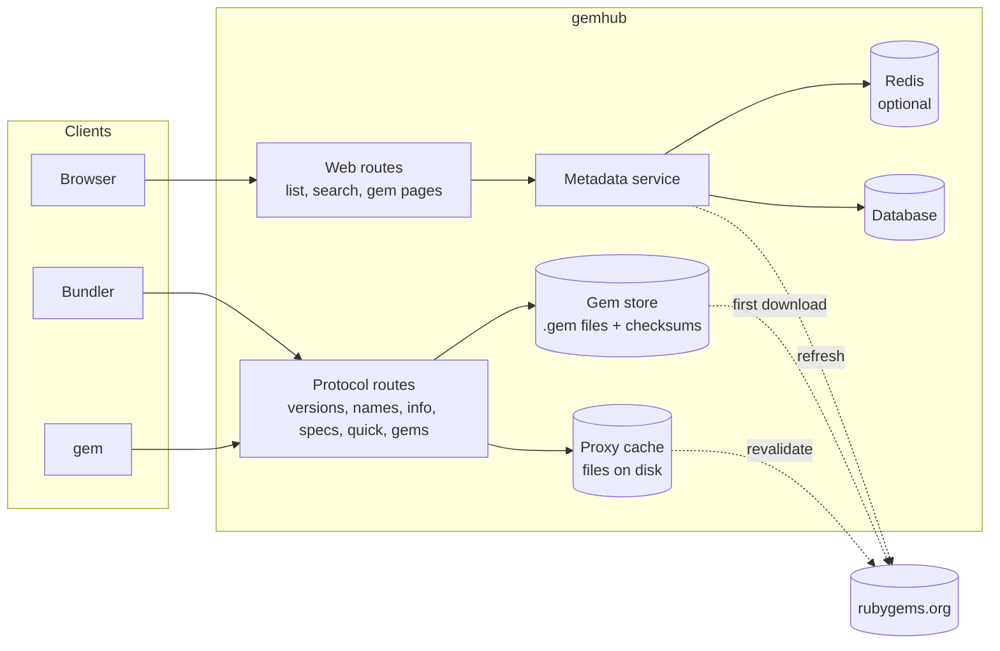
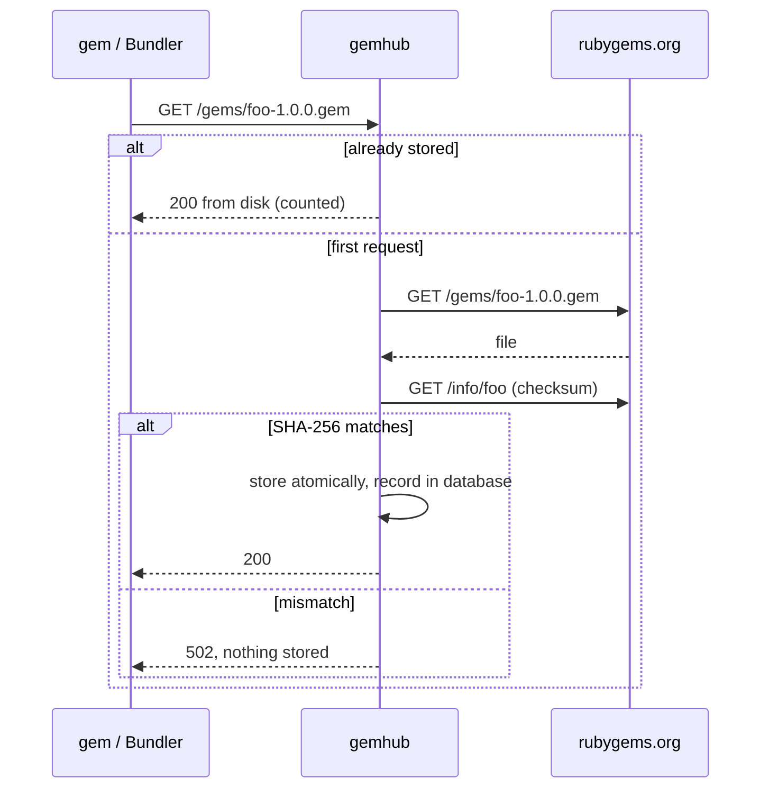
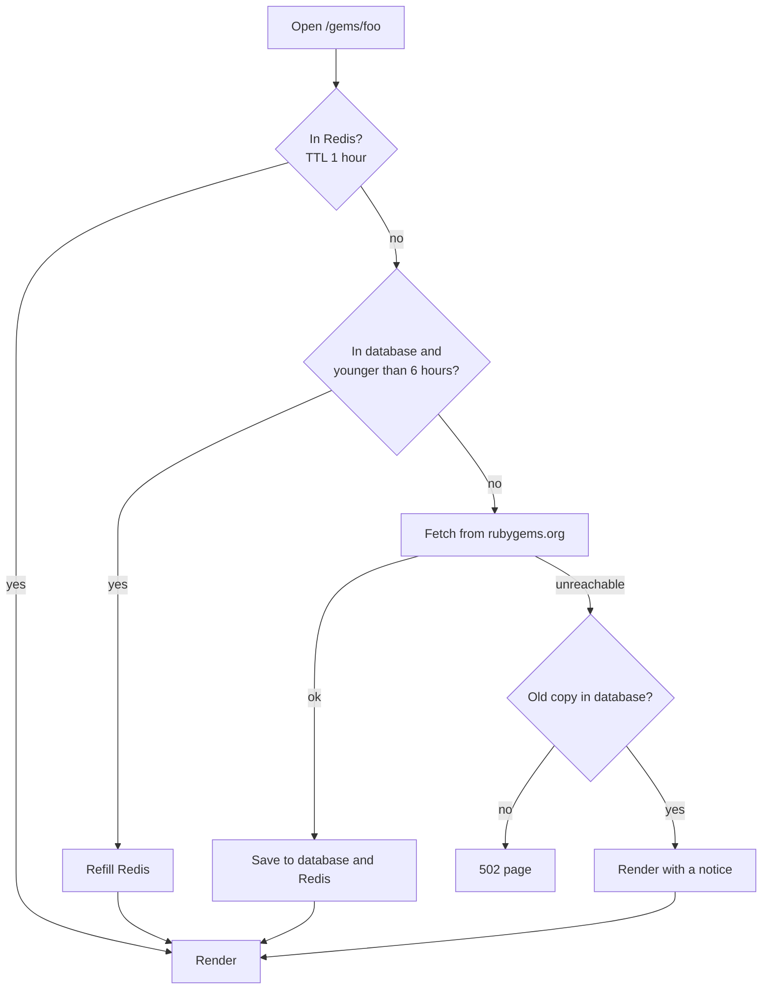

# gemhub

A caching RubyGems mirror with a web hub, in the spirit of `pypihub`. Point `gem` and Bundler at it and every gem is fetched from rubygems.org once, verified, stored, and served locally from then on. Open it in a browser to search rubygems.org and browse a rubygems.org-style page for each gem.

- **Works with the real clients.** `gem install` and Bundler (compact index) are covered by an end-to-end test that runs the actual Ruby tools against the hub.
- **Verified downloads.** A `.gem` is compared with the SHA-256 in the compact index before it is stored. A mismatch is rejected and never cached.
- **Survives outages.** If rubygems.org is down, cached indexes and gems keep being served (`stale-if-error`).
- **Web hub.** Dark and light themes, paginated list of cached gems, search, gem pages with install snippets, versions, dependencies, download statistics (rubygems.org totals plus what this hub served, with a 30-day chart).
- **Private gems.** `gem push` your own gems to the hub, with API keys, ownership, yank and a guard against dependency-confusion attacks. They install with `gem` and Bundler next to public gems.
- **Any database, with migrations.** SQLAlchemy plus Alembic: SQLite by default, PostgreSQL tested, MySQL/MariaDB supported by the code. Optional Redis.
- **Single process, no build step.** No Node, no CSS toolchain, no external fonts or CDNs, so it renders on an isolated network.

## Quick start

```bash
pip install gemhub            # or: pip install "gemhub[postgres]"
gemhub serve                  # http://127.0.0.1:8080
```

Docker, with PostgreSQL and Redis:

```bash
cp .env.example .env          # set POSTGRES_PASSWORD
docker compose up -d
```

### Use it

```bash
# Bundler, for every project (recommended)
bundle config set --global mirror.https://rubygems.org http://localhost:8080

# Or per project, in the Gemfile
#   source "http://localhost:8080"

# RubyGems command line
gem install rails --clear-sources --source http://localhost:8080
```

When serving over the network, put TLS in front (Caddy, nginx, Traefik) and set `GEMHUB_PUBLIC_URL` and `GEMHUB_TRUST_PROXY_HOPS=1`.

## Private gems

Create a key (the secret is printed once; only its hash is stored):

```bash
gemhub key create ci --scopes push,yank     # scopes: push, yank, admin
gemhub key list
gemhub key revoke ci
```

Publish with the normal RubyGems tools:

```bash
export GEM_HOST_API_KEY=gh_xxx
gem build acme_billing.gemspec
gem push --host http://localhost:8080 acme_billing-1.0.0.gem
gem yank acme_billing -v 1.0.0 --host http://localhost:8080      # hide a version
```

Then use it like any other gem: `source "http://localhost:8080"` in the Gemfile, or `gem install acme_billing --clear-sources --source http://localhost:8080`. The web hub marks private gems and includes them in search.

Rules the hub enforces:

- **Ownership.** The key that first pushes a name owns it; other keys get 403 unless they have the `admin` scope.
- **No re-pushing.** A version can be pushed once, even after it was yanked, as on rubygems.org.
- **Private names win.** A name that exists on the hub is always answered by the hub, never by rubygems.org, so a client cannot be tricked into fetching a public gem with the same name.
- **Public names are protected.** By default pushing a name that already exists on rubygems.org is refused (otherwise you would hijack that name for every client of the hub). Set `GEMHUB_PRIVATE_NAME_POLICY=allow` to permit deliberate shadowing, for example a private fork.
- **Validated uploads.** The archive is parsed without extracting it, metadata is size-limited, the YAML never instantiates objects, `checksums.yaml.gz` is verified, and `GEMHUB_MAX_GEM_BYTES` (default 100 MB) caps uploads.
- **Offline friendly.** Private gems keep working when rubygems.org is unreachable.

## Database migrations

gemhub uses [Alembic](https://alembic.sqlalchemy.org/), the migration tool of the SQLAlchemy project. Each schema change is a small numbered script; the database records which ones it has applied, so upgrading means "apply the missing scripts" rather than recreating tables, and existing data is kept.

```bash
gemhub db-status      # current revision, latest revision, history
gemhub migrate        # apply pending migrations (they also run on start)
```

- Migrations run automatically at start unless `GEMHUB_AUTO_MIGRATE=false` (do that if you prefer to run `gemhub migrate` as a separate deploy step).
- A database created by gemhub 0.1 has no version table; it is detected and adopted at the baseline revision, then upgraded, with its data intact.
- On PostgreSQL and MySQL a database lock stops several workers from migrating at once.
- Adding a change: edit `src/gemhub/models.py`, then add a script under `src/gemhub/migrations/versions/`. A test fails if the models and the migrations ever disagree.

## How it works



[](https://raw.githubusercontent.com/licface15/images/refs/heads/main/gemhub/architecture1.jpg)

### Gem download



[](https://raw.githubusercontent.com/licface15/images/refs/heads/main/gemhub/architecture2.jpg)

### Metadata freshness for gem pages



[](https://raw.githubusercontent.com/licface15/images/refs/heads/main/gemhub/architecture3.jpg)

Without Redis the same short-lived layer is kept in memory inside the process.

## Configuration

All settings are environment variables.

| Variable | Default | Purpose |
|---|---|---|
| `GEMHUB_DATA_DIR` | `./data` | Gem files, protocol cache, default SQLite file |
| `GEMHUB_DATABASE_URL` | SQLite in data dir | Any SQLAlchemy URL, e.g. `postgresql+psycopg://user:pw@host/db` |
| `GEMHUB_REDIS_URL` | none | Enables Redis for the short-lived metadata cache |
| `GEMHUB_UPSTREAM_URL` | `https://rubygems.org` | Upstream server |
| `GEMHUB_PUBLIC_URL` | derived from the request | Address shown in install snippets |
| `GEMHUB_HOST` / `GEMHUB_PORT` / `GEMHUB_THREADS` | `127.0.0.1` / `8080` / `16` | Server binding |
| `GEMHUB_TRUST_PROXY_HOPS` | `0` | Reverse proxies in front (reads `X-Forwarded-*`) |
| `GEMHUB_REDIS_TTL` | `3600` | Gem page metadata in Redis, seconds |
| `GEMHUB_DB_TTL` | `21600` | Gem page metadata in the database, seconds |
| `GEMHUB_VERSIONS_TTL` | `60` | Compact index `/versions` and `/names` |
| `GEMHUB_INFO_TTL` | `15` | Compact index `/info/<gem>` |
| `GEMHUB_SPECS_TTL` / `GEMHUB_QUICK_TTL` | `900` / `86400` | Legacy index and per-version specs |
| `GEMHUB_NEGATIVE_TTL` | `60` | How long a 404 from upstream is remembered |
| `GEMHUB_STALE_IF_ERROR` | `604800` | Serve a cached copy up to this old when upstream fails |
| `GEMHUB_CACHE_MAX_BYTES` | `0` | Evict least recently used gems above this size (0 = unlimited) |
| `GEMHUB_VERIFY_CHECKSUMS` | `true` | Compare downloads with the compact index checksum |
| `GEMHUB_AUTO_MIGRATE` | `true` | Apply database migrations at start |
| `GEMHUB_MAX_GEM_BYTES` | `104857600` | Largest accepted `gem push` |
| `GEMHUB_PRIVATE_NAME_POLICY` | `reject-public` | `reject-public` or `allow` (see Private gems) |
| `GEMHUB_PAGE_SIZE` | `24` | Gems per page on the home page |
| `GEMHUB_UPSTREAM_RETRIES`, `GEMHUB_CONNECT_TIMEOUT`, `GEMHUB_READ_TIMEOUT` | `3`, `5`, `30` | Upstream HTTP client |
| `GEMHUB_LOG_LEVEL` | `INFO` | Logging |

`GEMHUB_INFO_TTL` is deliberately short. Bundler compares each `info` file with the checksum listed in `/versions`, so serving an `info` file much older than `/versions` can cause transient checksum mismatches. Raise it only if you accept that trade-off for fewer upstream requests.

## Commands

```bash
gemhub serve [--host H] [--port P] [--threads N]
gemhub migrate                      # apply database migrations (also run on start)
gemhub db-status
gemhub key create NAME [--scopes push,yank,admin] | list | revoke NAME
gemhub refresh rails rack           # re-fetch metadata now (names are case-sensitive)
gemhub purge --older-than-days 90 [--dry-run]
gemhub stats
```

## Endpoints

| Path | Notes |
|---|---|
| `/versions`, `/names`, `/info/<gem>` | Compact index. `/versions` supports `Range`, updated by verified ranged requests |
| `/specs.4.8.gz`, `/latest_specs.4.8.gz`, `/prerelease_specs.4.8.gz`, `/quick/Marshal.4.8/*` | Legacy index |
| `/api/v1/dependencies?gems=a,b` | Passed through; relays whatever upstream answers |
| `POST /api/v1/gems`, `DELETE /api/v1/gems/yank`, `PUT /api/v1/gems/unyank` | `gem push`, `gem yank`, `gem yank --undo` (API key required) |
| `/gems/<name>-<version>.gem` | Verified, cached gem files (`/downloads/…` also accepted) |
| `/api/v1/gems/<gem>.json`, `/api/v1/versions/<gem>.json`, `/api/v1/search.json` | Read-only JSON passthrough |
| `/`, `/search`, `/gems/<gem>`, `/gems/<gem>/versions` | Web hub |
| `/healthz`, `/readyz`, `/_hub/stats`, `/robots.txt` | Operations |

## Security notes

- Names from URLs are validated before they touch the filesystem or upstream.
- Metadata from upstream is untrusted: HTML is escaped and only `http(s)` links are rendered.
- HTML responses carry a nonce-based Content-Security-Policy; there are no inline styles or third-party assets.
- API keys are 256-bit random values; only their SHA-256 is stored, and a key can be revoked at any time.
- Gems already cached stay available even if upstream later yanks them. That is usually what a mirror is for, but delete the file (or `gemhub purge`) if you need yanks to propagate.

## Limitations

- **Private gems are for the `ruby` platform only.** Platform-specific gems (for example `x86_64-linux`) are rejected on push.
- **Private gems are not in the legacy index.** They work with `gem install`, `gem push` and Bundler (compact index and quick specs). `gem search --remote`, which reads `specs.4.8.gz`, and the old dependency API do not list them, because merging into those large Marshal files is not implemented.
- Migrations were exercised on SQLite and PostgreSQL 16. MySQL/MariaDB support is written but has not been run.
- `waitress` runs one process with threads. Scale out with several containers sharing PostgreSQL, Redis and a shared data volume.
- `/info` and `/versions` consistency and the ranged `/versions` update were tested against a mock upstream and the real `gem` and Bundler clients, not against production rubygems.org traffic. Try it on your own network before relying on it.

## Development

```bash
pip install -e ".[dev]"
pytest
ruff check src tests && ruff format --check src tests

# real gem + Bundler end-to-end (needs Ruby)
tests/e2e/build_fixture.sh /tmp/fixture
python tests/e2e/run_ruby_e2e.py /tmp/fixture
python tests/e2e/run_private_e2e.py /tmp/fixture

# run the whole suite on PostgreSQL instead of SQLite
GEMHUB_TEST_DATABASE_URL=postgresql+psycopg://user:pw@localhost/gemhub_test pytest
```

## License

[MIT](LICENSE)


## 👤 Author
        
[Hadi Cahyadi](mailto:cumulus13@gmail.com)
    

[](https://www.buymeacoffee.com/cumulus13)

[](https://ko-fi.com/cumulus13)
 
[Support me on Patreon](https://www.patreon.com/cumulus13)